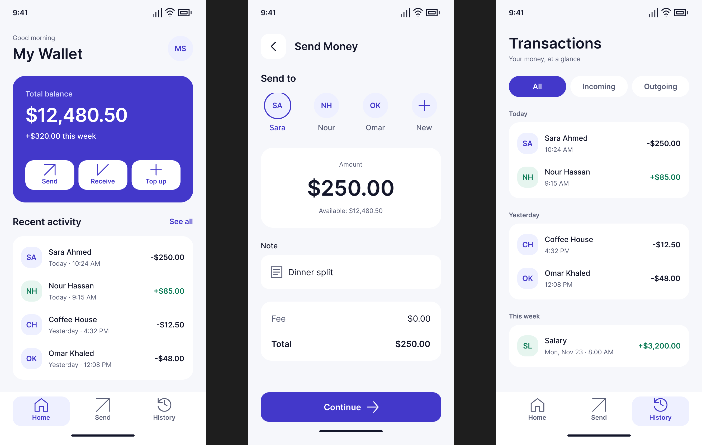

# Datheon UI/UX Internship

Portfolio of tasks completed for the Datheon UI/UX internship.

## Task 1: Fintech Mobile Wallet App Redesign

Three high-fidelity mobile screens (390x844) designed in Figma:
1. **Home**: balance overview with quick actions and recent activity
2. **Send Money**: peer-to-peer transfer flow
3. **Transaction History**: filterable list grouped by date

- Figma file: https://www.figma.com/design/0UOkAmMdqMt4I9fQZzvVE4/Datheon---Task-1---Fintech-Wallet?node-id=0-1&t=KAQDfdrdrUyy66cM-1

### Design notes
- Auto Layout used on all frames, cards, and rows
- Reusable components: Transaction Row, Primary Button, Secondary Button, Filter Chip, Contact Avatar, Bottom Navigation, Input Field
- Color Styles and Text Styles applied (Inter font)

### Tools
Figma. A first draft was generated with Figma's AI agent, then reviewed and refined by me.

## Task 2: Design System and Component Library
Coming soon
